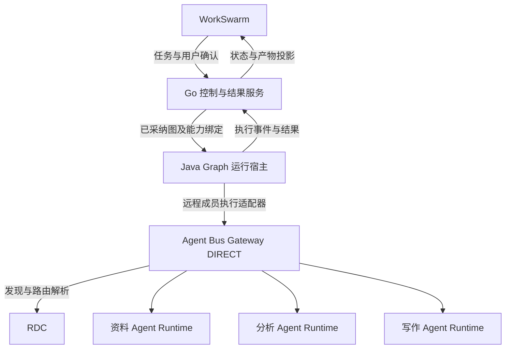

# Issue 16 Agent Bus 接入执行计划

将现有授信 Demo 的进程内专业 Agent 接入真实 Agent Bus，完成能力发现、Gateway DIRECT 调用、节点与远端任务关联，以及断连和重启时的结果控制。以一个远程 `report-writer` 为首条链路，再扩展到资料、分析、写作三个角色。

| 项目 | 约定 |
| --- | --- |
| 创建日期 | 2026-11-11 |
| 状态 | Agent Bus 接入已实施并完成授信场景验收；W06 年报业务逻辑仍为外部依赖，详见[验收记录](issue16-agent-bus-results.md) |
| 需求依据 | [Issue #16](https://github.com/chaosxingxc-orion/agent-hub-alpha/issues/16)，以 W05 为主，包含必要的 W03/W04/W07 接口配合 |
| 预计投入 | 5–7 人日：5 天核心实现，预留 1–2 天联调、修复和复测 |
| 阶段目标 | 单个真实 Agent 调通约 1–2 人日；三角色正常链路约累计 3–4 人日；故障验证和交付约累计 5–7 人日 |
| 排期假设 | 一名熟悉当前项目的开发者实施；环境和模型接入可用；三角色业务逻辑由 W06 提供 |
| 日期口径 | D1 为实际启动日；首次组件联调若占用两天，后续节点相应顺延 |

## 目标与范围

完成后，用户在 WorkSwarm 创建并确认任务，Java Graph 宿主按已采纳图经 Gateway DIRECT 调用独立 Agent Runtime，Go 保存调用关联、正式结果和状态投影。模型只能选择受控能力，不能任意拼接服务地址或扩大工具权限。

本次实施范围：

- 复用真实 RDC、Gateway DIRECT 和 Agent Runtime，提供真实 AgentCard、受控能力清单和可信路由绑定。
- 在现有 Graph 成员接口增加远程执行适配器，保留 Java 作为唯一执行推进者。
- 记录节点、执行尝试、输入、远端调用和正式结果之间的对应关系。
- 补齐本链路必需的持久化失败处理、重复结果控制、等待/未知状态和恢复验证。
- 扩展当前部署包、界面状态投影和故障验证脚本。

年报材料提取、指标计算、引用核验和报告验收属于 W01/W06 及相关控制工作，不计入本计划的总线接入估算。W06 未提供角色逻辑时，可用现有授信成员继续验证接入，但不能据此宣布年报三角色验收完成。

沿用 openJiuwen、WorkSwarm、Agent Bus 和 Loop Forest。新增部分限定为接口适配、场景配置和缺失控制；不另建注册中心、前端主壳或 Go 调度引擎。首期采用 DIRECT，不部署 BUS/relay/broker 链路。[Issue #6](https://github.com/chaosxingxc-orion/agent-hub-alpha/issues/6) 是可选知识增强服务，不作为启动依赖。System1/Jev 不进入本次要求。

## 当前基线

以下为实施前基线。已从 `demo/issue16-deploy` 建立 `feat/issue16-agent-bus`，以 `5051d3a` 保存原可运行工作区及计划，再实施接入；私有缓存中另保留数据和镜像备份。

| 组件 | 当前基线与接入点 |
| --- | --- |
| 仓库 | `agent-hub-alpha`；当前分支 `demo/issue16-deploy`；HEAD `f707dd9a59187a0c8e8c53a9003bf7134da14c62`，另有工作区改动 |
| 授信原型 | 选择性引入 [WangHaowen99/agent-hub-alpha @ 46980e8](https://github.com/WangHaowen99/agent-hub-alpha/tree/46980e84bf12e9a0fbfa860614822509bf299db5) 的 `credit-demo` 和 `credit-orchestrator` |
| Java 执行入口 | [Worker.java](../examples/credit-orchestrator/src/main/java/com/openjiuwen/demo/credit/Worker.java) 的 `member()` 创建本地 Agent；`Ledgered` 包装结果复用；`BlueprintScheduler` 推进 Graph |
| Go 能力目录 | [catalog.go](../go/cmd/credit-demo/catalog.go) 当前为本地预置能力，不是真实 RDC 发现结果 |
| Go 结果记录 | [service.go](../go/cmd/credit-demo/service.go) 当前 `save()` 仅记录写入错误；`StepPut()` 缺少完整输入与契约冲突校验，需要纳入本链路修正 |
| solution | `bf702bc95064d3491cf8b374f54d271363d84230` |
| WorkSwarm | `1142e5fb3984a2b1bc6352669a464976e204b2dc`，沿用当前可运行基线；与 #16 引用版本的差异单独记录 |
| Java Core | `com.openjiuwen:agent-core-java:0.1.17` |
| 版本记录 | [sources.lock.json](../go/cmd/credit-demo/deploy/sources.lock.json)；D1 补齐 Runtime、RDC、Gateway、A2A 客户端及实际协议的构建矩阵 |

上游复用依据：[Agent Bus 固定源码](https://gitcode.com/openJiuwen/agent-solution/blob/bf702bc95064d3491cf8b374f54d271363d84230/common/agent-bus/README.md)、[多智能体调研示例](https://gitcode.com/openJiuwen/agent-solution/blob/bf702bc95064d3491cf8b374f54d271363d84230/common/example/multi-deep-research-demo/README.md)。示例中的客户端须与选定 Gateway 的地址、鉴权和消息格式实测匹配，不能仅凭名称判断可直接替换。

## 调用关系与职责

能力白名单保存业务适用范围、输入输出要求和可信能力引用；RDC 管理真实卡片及运行实例发现，Gateway 解析并转发。任务采纳时固定能力与契约版本；物理实例变化仍须符合该绑定，不能静默替换成不同能力。

专业 Agent 优先分进程部署，可复用同一个镜像并按角色配置启动。分析角色承接两个独立节点，每次执行隔离上下文、MCP 工具挂载和授权。Loop Forest 仍在已授权节点范围内运行。

## 每日交付

| 时间 | 实施内容 | 交付与通过条件 |
| --- | --- | --- |
| D1 | 保存可回滚基线；锁定版本和协议；启动数据库、RDC、Gateway DIRECT；封装远程 `report-writer` | 真实 AgentCard 可读取、可发现；经 Gateway 完成一次真实模型调用；保存脱敏请求、响应和运行记录 |
| D2 | 增加远程成员执行器；补最小调用记录和相关持久化失败处理；连接现有界面 | WorkSwarm 创建并确认任务后，由 Graph 调用远程写作 Agent；正式结果持久提交后显示成功并推进依赖 |
| D3 | 接入资料、分析、写作三类服务；对齐真实卡片和能力白名单；验证两个分析节点并行 | 三角色均经 Gateway 调用；上下文、工具权限和结果不串线；缺角色逻辑时明确登记 W06 依赖 |
| D4 | 完善身份与输入校验、远端任务关联、结果防覆盖、等待/未知和恢复 | 同身份换输入报冲突；超时后查询原任务或进入未决；已完成节点恢复时复用原结果 |
| D5 | 沿真实链路注入断连、迟到响应、进程终止和存储失败 | 核心故障用例通过；保存原始事件、调用次数、产物摘要与恢复行为 |
| D6–D7 | 修复兼容性问题；从交付包重新部署；复测并冻结版本 | 体验环境、版本矩阵、部署包、证据、操作说明和已知限制齐备 |

D1–D3 是集成目标，不能替代 D4–D7 的可靠性和交付验证。负责人及协作人于启动时登记，不把本计划视为他人的工期承诺。

## 实施清单

### 基线与协议

- [x] 保存完整工作区基线、现有部署配置和数据备份，记录恢复方式。
- [x] 以该基线建立实施分支，建议名称 `feat/issue16-agent-bus`；保留现有体验环境的可回滚入口。
- [x] 锁定实际构建矩阵，包括 JDK、Core、Runtime、solution、RDC/Gateway、A2A 客户端和模型配置。
- [x] 验证选定 Gateway 的调用、任务查询、鉴权、AgentCard 和错误响应格式；保存协议样例。
- [x] 测量新增 JVM 与数据库的资源占用，确定容器内存和启动顺序；只操作本项目服务。

### 真实能力接入

- [x] 为首个 `report-writer` 复用上游 AgentHandler/Runtime 封装，暴露真实 AgentCard 和调用接口。
- [x] 按固定 RDC 版本支持的部署发现或注册机制接入服务，验证健康状态和实际路由。
- [x] 将受控能力清单绑定真实能力 ID 和版本；目录不可用或契约不匹配时显式拒绝。
- [x] 增加远程成员适配器，保留现有 Graph 调度与结果复用入口；完整解析协议错误，不能把 HTTP 200 一律当成功。
- [x] 按本计划的 W06 缺交接处理接入授信资料、分析、写作三角色；验证两个分析节点的上下文和工具授权隔离。年报业务逻辑未交接，不计作 W06 完成。
- [x] 模型只能看到获准能力和必要输入；服务地址、凭据及工具作用域由可信配置和服务端绑定。

### 记录与恢复

- [x] 补齐下节约定的节点身份、输入摘要、执行尝试和远端关联字段。
- [x] 派发前持久保存调用意图；保存失败时停止派发。
- [x] 修正相关写入错误传播及失败后的内存状态，避免重启前后出现不同的成功结果。
- [x] 正式结果提交时校验输入、契约和执行权限；持久提交成功后才允许依赖节点消费。
- [x] 区分重复、冲突和迟到结果，保留原正式结果及必要审计记录。
- [x] 增加明确的等待/未知状态；查询、恢复沿用原身份，不自动把未决状态转换成重试。
- [x] 验证宿主、Gateway 和 Agent Runtime 各自重启后的行为，记录可恢复与需人工处理的范围。

### 投影与交付

- [x] 现有 WorkSwarm 集成入口展示真实节点状态、结果和等待原因；技术关联字段放入必要的诊断详情。
- [x] 扩展 Compose、构建脚本、健康检查、持久卷和版本记录，密钥仅从运行配置注入。
- [x] 完成本计划的验收用例，并归档脱敏原始证据。
- [x] 从交付包重新部署并复跑演示，更新部署说明和已知限制。

## 接口与结果语义

优先复用 #16 及上游已有 schema。字段名称可以调整，以下语义必须保留。

| 信息 | 最小约定 |
| --- | --- |
| 节点身份 | `taskId + graphRevision + nodePath + loopIteration`；子流程包含父级执行上下文，映射稳定的 `nodeExecutionId` |
| 执行尝试 | `attempt` 表示同一节点的一次尝试；查询不会产生新尝试，尝试变化不会创建新的业务节点 |
| 输入与绑定 | 实际输入摘要、上游产物引用、能力 ID、契约/能力版本，以及影响执行的必要配置版本 |
| 远端关联 | 请求/消息标识，以及远端实际返回的 `taskId/contextId`；同步完成且无任务号时保存请求与响应关联 |
| 正式结果 | 产物标识、内容摘要、来源调用；同一个节点执行实例正式结果至多一份 |
| 状态事件 | 事件标识/序号、执行状态、错误或等待原因；重复和乱序事件不能导致状态倒退 |

执行顺序：

1. 读取已采纳图、可信能力绑定和节点正式结果。输入与契约一致且结果已存在时直接复用；同身份换输入报冲突。
2. 对没有正式结果的节点检查既有调用记录；无未决调用时，先持久记录派发意图，再发送远端请求。
3. 保存远端受理信息与任务标识。发送前后崩溃或响应丢失形成的不确定窗口必须保持可辨认，不能以缺少结果推断“未执行”。
4. 有足够信息时查询原任务；无法确定远端状态时进入未决/人工处理，不创建第二份调用。
5. 校验响应身份、输入和契约，检查当前执行权限；持久提交正式结果及关联后，才向 Graph 返回可供依赖节点消费的成功结果。
6. 重复提交相同结果返回原记录；冲突结果拒绝；旧尝试、失效执行者及迟到响应不能覆盖正式结果。

相关提交必须保证落盘失败不会留下可被当成成功复用的内存状态；调用关联与正式结果的提交边界保持一致。复用现有 W04 存储接口并以故障实验验证，不能只修改日志或只检查写文件函数返回值。

Java 宿主负责决定继续、等待和恢复。远端未决时，阻止依赖该结果的新节点继续执行；Go 仅记录和投影事实。已完成节点恢复后的模型调用增量必须为零；尚未提交的纯计算不承诺物理调用 exactly-once。

## 代码与部署改动位置

实际改动沿用下列接口位置；新控制逻辑集中在 `bus.go`，远端封装位于 `examples/professional-agent-runtime`。

| 位置 | 改动 |
| --- | --- |
| `examples/credit-orchestrator/.../Worker.java` | 在 `member()` 接入远程执行器；保留 `BlueprintScheduler` 和结果复用入口；处理等待与未决，避免统一落为普通失败后重试 |
| `examples/credit-orchestrator/.../GoClient.java` | 沿用现有 HTTP 客户端，由 `RemoteAgentMember` 调用新增控制接口 |
| `examples/credit-orchestrator` 新增适配器 | 已实现 `RemoteAgentMember`，复用与固定 Gateway 匹配的客户端，承接协议结果与现有成员接口之间的映射 |
| 新增专业 Agent Runtime 模块 | 复用上游 Runtime/AgentHandler；按角色配置独立进程、真实卡片、输入输出和工具作用域 |
| `go/cmd/credit-demo/catalog.go` | 保留场景白名单和契约控制；绑定真实能力，不承担运行实例注册与地址选择 |
| `go/cmd/credit-demo/service.go` | 扩展调用记录与结果校验；补齐持久化错误、冲突、未决和恢复状态 |
| 现有图卡与查询投影 | 显示真实等待原因和结果关联，保持 WorkSwarm 单一入口 |
| `go/cmd/credit-demo/deploy/` | 扩展或增加总线 Compose 配置、镜像构建、版本锁定和验证脚本 |

## 验收用例

下列为本计划的授信场景验证结果。单元测试与真实链路覆盖分别列明；对应 #16 的某一部分通过，不自动代表年报场景验收或整个工作包完成。原始证据与具体任务编号见[验收记录](issue16-agent-bus-results.md)。

| 编号 | 用例 | 通过条件 | 对应范围 | 状态 |
| --- | --- | --- | --- | --- |
| BUS-01 | 真实发现与调用 | 三类真实 AgentCard 可发现；请求经 Gateway DIRECT；目标 Agent 有对应执行记录和产物 | W05、A01 调用部分 | 通过：真实 RDC/Gateway，主环境 R10、全新环境 R1 |
| BUS-02 | 未授权能力或伪造目标 | 未授权能力、模型给定的任意服务地址及契约不匹配被拒绝；无远端派发 | A02 能力部分 | 通过：真实 MCP/协议拒绝；契约漂移单元测试 |
| BUS-03 | 两个分析节点并行 | 真实执行时间重叠；输入、上下文、工具权限和输出隔离 | A01 并行部分 | 通过：运行时间重叠、独立上下文；越权单元测试 |
| BUS-04 | 同身份换输入与重复结果 | 换输入冲突；同结果重复提交复用原记录；冲突或迟到结果不能覆盖 | A04、A06 | 通过：控制层冲突/重复/旧身份测试 |
| BUS-05 | 已完成节点后强杀宿主 | 恢复读取原图；已完成节点产物标识、摘要不变，模型调用增量为零 | A05 | 通过：主环境 R11、全新环境 R2 强杀；完成节点模型记录零增量 |
| BUS-06 | 远端处理中断线或回复迟到 | 查询原任务或保留未决；无盲目重发；迟到结果不能覆盖正式结果 | A06 | 通过：R12 断线、R13 迟到；原请求/任务不变 |
| BUS-07 | 派发意图或结果写入失败 | 必需记录未提交则不派发；结果未提交则不显示完成、不推进依赖；恢复后可核对 | A13 | 通过：派发/结果失败单元测试；R14 实际 rename 失败并恢复 |
| BUS-08 | Gateway 或 Agent Runtime 重启 | 实测原任务可查询性；不能查询时明确进入未决/人工处理，不伪称自动恢复 | A06 恢复边界 | 通过边界验证：R15/R16 重启后未决，需人工核对 |
| BUS-09 | 协议和依赖错误 | HTTP 200 中的协议错误不能当成功；鉴权、RDC 不可用、服务失败和未知状态可区分 | W05 错误路径 | 通过：协议/鉴权、RDC 停机、Runtime 拒绝执行 |
| BUS-10 | 重复或乱序事件与界面刷新 | 状态不倒退、不重复计数；刷新后读取持久状态 | A12 接入部分 | 通过：乱序/幂等单元测试；全新环境重启/刷新 |
| BUS-11 | 全新部署与缺配置 | 固定版本可启动并复跑真实链路；缺必需配置显式失败；重启保留正式结果 | A15 接入部分 | 通过：全新项目/数据卷 R1；缺配置拒绝；重启保留结果 |

恢复验收使用按节点归属、跨重启可核对的模型调用计数或可核对记录。普通运行日志、截图和最终结果相同不能单独证明“已完成节点调用增量为零”。

## 依赖与风险处理

| 依赖或风险 | 处理与关口 |
| --- | --- |
| W06 三角色逻辑尚未交接 | D1 对齐输入输出、工具、材料和配置；接入测试可先用现有授信成员推进，年报三角色验收保持待完成 |
| Runtime、Gateway 与客户端协议不匹配 | D1 实测调用、鉴权、查询和错误路径；固定成功组合，再扩展角色，不在整个项目中盲目升级依赖 |
| Gateway 任务归属索引为内存实现 | D1 开始验证重启影响；归属丢失且无法查询时进入未决/人工处理。自动恢复若需新增上游持久化能力，另列增量及工期 |
| 现有 Go 原型吞掉存储错误 | D2 前补齐调用与结果路径上的错误传播和提交边界；未通过 BUS-07 不声明正式结果可靠 |
| 新增多个 JVM 与数据库的资源压力 | D1 测量资源并配置限额；构建和启动不修改宿主全局配置或影响其他项目 |
| 当前工作区包含未提交文件 | 实施前保存完整基线和数据；回滚同时核对镜像、配置和数据格式，不只切换代码 |

图映射、身份和等待语义与 W03 对齐，正式结果及持久接口与 W04 对齐，部署和证据与 W07 对齐。本计划仅包含总线接入所需的最小改动，不替代各工作包完整交付。

## 交付与执行记录

- [x] 体验环境及入口：可操作真实远端节点，显示结果、等待原因和失败状态。
- [x] 代码与版本：实施提交、实际构建矩阵、镜像标识、非敏感配置版本和未完成项。
- [x] 部署包：启动、健康检查、停止、数据保留、备份与回滚说明，能够从交付包重新部署。
- [x] 三段演示：正常协作、已完成节点中断恢复、断连或迟到响应的受控处理。
- [x] 验收证据：BUS-01—BUS-11 的输入、预期、实际结果、原始事件和产物引用。
- [x] 范围说明：已接角色、故障覆盖、W06 依赖和上游恢复限制，不自动关闭 #16 其他工作包。

证据建议保存在项目缓存的 `evidence/agent-bus/` 子目录，交付时提供可访问的归档入口。每次验收至少记录用例编号、代码与镜像版本、部署配置版本、任务/节点标识、输入摘要、操作步骤、原始事件、远端调用记录、模型调用计数、产物标识/摘要、预期和实际结果。归档不包含密钥、令牌或完整敏感环境变量。

执行中更新下表和上方清单；只有交付物及证据齐备后才勾选完成。

| 日期 | 阶段或用例 | 执行人 | 代码与证据入口 | 结果及下一步 |
| --- | --- | --- | --- | --- |
| 2026-11-11 | 基线、协议、接入、控制 | Codex（按本会话授权） | `5051d3a` 基线；`7bb7f27` 实现；`d17f304` 验收身份记录 | 复用上游 Bus/Runtime；Go 控制与 Java 成员适配已完成 |
| 2026-11-11 | BUS-01—BUS-10 | Codex | `evidence/agent-bus/`；[验收记录](issue16-agent-bus-results.md) | 真实调用、强杀恢复、断线、迟到、存储故障和重启边界通过 |
| 2026-11-11 | BUS-11 与交付 | Codex | 全新 Compose 项目、独立卷及 `fresh-restart.json` | 全新部署与正式结果持久复用通过；不关闭 W06 或 #16 其他工作包 |

部署入口见 [Issue 16 构建与部署说明](../go/cmd/credit-demo/deploy/README.md)。
